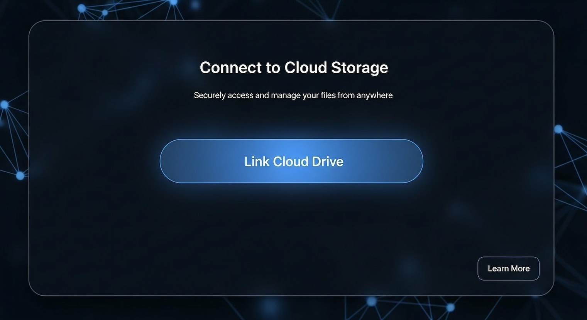
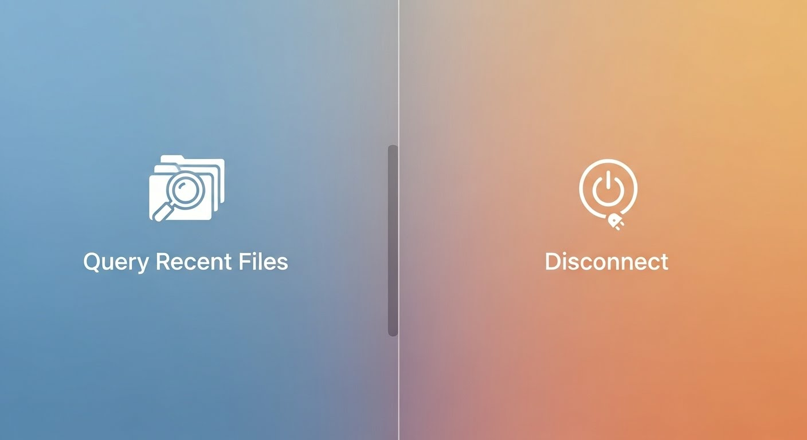

# LINE Bot 檔案備份機器人

把 LINE 聊天室裡的圖片、影片、音訊和檔案，一鍵備份到**你自己的** Google Drive，並自動依年月整理歸檔。

[](https://github.com/kkdai/linebot-file/actions/workflows/go.yml)
[](https://goreportcard.com/report/github.com/kkdai/linebot-file)
[](https://www.apache.org/licenses/LICENSE-2.0)


---

## 目錄

- [功能](#功能)
- [運作方式](#運作方式)
- [指令](#指令)
- [部署到 Google Cloud Platform](#-部署到-google-cloud-platform)
- [環境變數](#環境變數)
- [本機開發](#本機開發)
- [專案結構](#專案結構)
- [隱私與安全](#隱私與安全)
- [路線圖](#路線圖)
- [貢獻](#貢獻)
- [授權](#授權)

---

## 功能

- **多媒體備份** — 圖片、影片、音訊、一般檔案，傳到聊天室就自動上傳。
- **自動歸檔** — 檔案存進 `LINE Bot Uploads/YYYY-MM/`，雲端硬碟不會變成一團亂。
- **安全授權** — 走標準 Google OAuth 2.0，只取得 `drive.file` 權限（見[隱私與安全](#隱私與安全)）。
- **檔案查詢與搜尋** — `/recent_files` 看最近上傳，`/q 關鍵字` 找舊檔案。
- **隨時斷開** — `/disconnect_drive` 會向 Google 撤銷授權並刪除本地憑證。
- **狀態化選單** — Rich Menu 會依連線狀態自動切換。

## 運作方式

```
LINE App ──傳送檔案──> LINE Platform ──webhook──> Cloud Run (本專案)
                                                     │
                                        讀取使用者 token ├──> Firestore
                                                     │
                                          上傳／查詢檔案 └──> Google Drive API
```

使用者第一次使用時執行 `/connect_drive`，機器人產生一組帶 CSRF state 的 Google 授權連結；使用者完成授權後，token 存進 Firestore，之後所有的 Drive 操作都以該使用者的身分執行。**檔案存在使用者自己的 Drive，本服務不保留任何檔案內容。**

## 指令

| 指令 | 說明 |
|------|------|
| `/connect_drive` | 連接 Google Drive 帳號 |
| `/reconnect` | 撤銷現有授權並重新連接（授權失效時使用） |
| `/disconnect_drive` | 中斷連線並向 Google 撤銷授權 |
| `/recent_files` | 列出最近上傳的 5 個檔案 |
| `/search_files <關鍵字>` | 依檔名搜尋已備份的檔案 |
| `/q <關鍵字>` | `/search_files` 的簡寫 |

指令僅在與機器人的一對一聊天中有效。直接傳送圖片、影片、音訊或檔案即可備份，不需要任何指令。

---

## 🚀 部署到 Google Cloud Platform

本專案已容器化，建議使用 [Google Cloud Run](https://cloud.google.com/run) 部署。

### 前置作業

1. 一個 Google Cloud 帳號與專案。
2. 安裝並設定好 [gcloud CLI](https://cloud.google.com/sdk/docs/install)。
3. 一個 LINE Bot 頻道，並取得 **Channel Secret** 與 **Channel Access Token**。

### 1. 啟用必要的 API

```bash
gcloud services enable run.googleapis.com cloudbuild.googleapis.com firestore.googleapis.com
```

### 2. 建立 Firestore 資料庫

到 Cloud Console 的 Firestore 頁面，選擇**原生模式 (Native mode)**，挑一個離使用者近的地區建立。

程式會用到兩個 collection，都會自動建立：

| Collection | 用途 |
|------------|------|
| `oauth_states` | 授權流程的 CSRF state，10 分鐘後失效 |
| `user_tokens` | 使用者的 Google OAuth token，以 LINE user ID 為文件 ID |

> 建議為 `oauth_states` 設定 [Firestore TTL policy](https://cloud.google.com/firestore/docs/ttl)（欄位選 `created_at`），自動清理過期文件。

### 3. 取得 Google OAuth 憑證

1. 前往 [APIs & Services → Credentials](https://console.cloud.google.com/apis/credentials)。
2. **+ CREATE CREDENTIALS** → **OAuth client ID** → **Web application**。
3. **Authorized redirect URIs 先留空**，等 Cloud Run 部署完拿到網址再回來填。
4. 記下 **Client ID** 與 **Client Secret**。

### 4. 建立 Rich Menu

Rich Menu 有兩種狀態：尚未連線時引導使用者授權，已連線後提供查詢與斷線功能。

 

**a. 建立選單物件**

將 `{TOKEN}` 換成你的 Channel Access Token：

```bash
# 「尚未連線」選單
curl -s -X POST https://api.line.me/v2/bot/richmenu \
  -H 'Authorization: Bearer {TOKEN}' \
  -H 'Content-Type: application/json' \
  -d '{
    "size": { "width": 2500, "height": 1686 },
    "selected": false,
    "name": "Connect Menu",
    "chatBarText": "點我開始",
    "areas": [
      {
        "bounds": { "x": 0, "y": 0, "width": 2500, "height": 1686 },
        "action": { "type": "message", "text": "/connect_drive" }
      }
    ]
  }'
```

```bash
# 「已連線」選單
curl -s -X POST https://api.line.me/v2/bot/richmenu \
  -H 'Authorization: Bearer {TOKEN}' \
  -H 'Content-Type: application/json' \
  -d '{
    "size": { "width": 2500, "height": 1686 },
    "selected": false,
    "name": "Main Menu",
    "chatBarText": "功能選單",
    "areas": [
      {
        "bounds": { "x": 0, "y": 0, "width": 1250, "height": 1686 },
        "action": { "type": "message", "text": "/recent_files" }
      },
      {
        "bounds": { "x": 1250, "y": 0, "width": 1250, "height": 1686 },
        "action": { "type": "message", "text": "/disconnect_drive" }
      }
    ]
  }'
```

兩個指令各會回傳一個 `richMenuId`，請都記下來。

**b. 上傳選單圖片**

圖片需為 **2500×1686** 像素、**小於 1MB**。專案內附的 `connect_menu.png` 與 `main_menu.png` 可直接使用。

```bash
curl -X POST https://api-data.line.me/v2/bot/richmenu/{RICH_MENU_ID}/content \
  -H "Authorization: Bearer {TOKEN}" \
  -H "Content-Type: image/png" \
  -T connect_menu.png
```

**c. 設定環境變數**

把兩個 `richMenuId` 填進 `RICH_MENU_CONNECT` 與 `RICH_MENU_MAIN` 環境變數即可，**不需要修改程式碼**。

### 5. 部署到 Cloud Run

```bash
gcloud run deploy linebot-file-service \
  --source . \
  --platform managed \
  --region asia-east1 \
  --allow-unauthenticated \
  --set-env-vars="ChannelSecret=YOUR_CHANNEL_SECRET" \
  --set-env-vars="ChannelAccessToken=YOUR_CHANNEL_ACCESS_TOKEN" \
  --set-env-vars="GOOGLE_CLIENT_ID=YOUR_GOOGLE_CLIENT_ID" \
  --set-env-vars="GOOGLE_CLIENT_SECRET=YOUR_GOOGLE_CLIENT_SECRET" \
  --set-env-vars="GOOGLE_REDIRECT_URL=https://temp.example.com/oauth/callback" \
  --set-env-vars="RICH_MENU_CONNECT=richmenu-xxxx" \
  --set-env-vars="RICH_MENU_MAIN=richmenu-yyyy"
```

`GOOGLE_REDIRECT_URL` 這次先隨便填，因為此時還不知道 Cloud Run 的網址。

> 正式環境建議把機密資料改放 [Secret Manager](https://cloud.google.com/run/docs/configuring/secrets)，用 `--set-secrets` 掛載，而不是直接寫在環境變數。

### 6. 回填網址並重新部署

部署完成後 Cloud Run 會給你一個網址，例如 `https://linebot-file-service-xxxx-an.a.run.app`。

1. **LINE Webhook**：到 [LINE Developers Console](https://developers.line.biz/) 把 Webhook URL 設為這個網址（根路徑即可），並開啟 **Use webhook**。
2. **Google Redirect URI**：回到步驟 3 的憑證頁面，在 **Authorized redirect URIs** 加入 `<你的網址>/oauth/callback`。
3. **重新部署**：再跑一次步驟 5 的指令，這次把 `GOOGLE_REDIRECT_URL` 改成正確的回呼網址。

完成後，在 LINE 加機器人好友並執行 `/connect_drive` 即可開始使用。

### HTTP 端點

| 方法 | 路徑 | 用途 |
|------|------|------|
| `POST` | `/` | LINE webhook（簽章由 Channel Secret 驗證） |
| `GET` | `/oauth/callback` | Google OAuth 回呼 |
| `GET` | `/healthz` | 健康檢查 |

---

## 環境變數

| 變數 | 必填 | 預設值 | 說明 |
|------|:----:|--------|------|
| `GOOGLE_CLOUD_PROJECT` | ✅ | — | GCP 專案 ID，用於連接 Firestore |
| `ChannelSecret` | ✅ | — | LINE Channel Secret，用於驗證 webhook 簽章 |
| `ChannelAccessToken` | ✅ | — | LINE Channel Access Token |
| `GOOGLE_CLIENT_ID` | ✅ | — | Google OAuth Client ID |
| `GOOGLE_CLIENT_SECRET` | ✅ | — | Google OAuth Client Secret |
| `GOOGLE_REDIRECT_URL` | ✅ | — | OAuth 回呼網址，須與 Google Console 設定一致 |
| `RICH_MENU_CONNECT` | | 內建 ID | 「尚未連線」Rich Menu 的 ID |
| `RICH_MENU_MAIN` | | 內建 ID | 「已連線」Rich Menu 的 ID |
| `PORT` | | `8080` | 監聽的連接埠，Cloud Run 會自動注入 |

缺少任何一個必填變數，服務會在啟動時直接失敗並說明原因。

---

## 本機開發

需要 Go 1.24 以上。

```bash
go mod download
go test ./...     # 執行測試
go run .          # 啟動服務（需先設定上表的環境變數）
```

LINE 的 webhook 必須是公開的 HTTPS 網址，本機開發請搭配 ngrok 之類的通道工具。詳細說明見 [CONTRIBUTING.md](CONTRIBUTING.md)。

## 專案結構

| 檔案 | 職責 |
|------|------|
| `main.go` | 啟動流程、環境變數檢查、HTTP 路由 |
| `config.go` | 常數與套件層級的共用狀態 |
| `webhook.go` | LINE 事件分派、指令解析、各指令的處理邏輯 |
| `line.go` | LINE 訊息組裝（文字、Flex、Quick Reply、Rich Menu） |
| `drive.go` | Google Drive 的查詢、上傳、資料夾管理 |
| `auth.go` | OAuth 流程、token 儲存與撤銷 |

## 隱私與安全

- **權限範圍最小化**：只要求 `drive.file` scope，機器人**只看得到自己建立的檔案**，無法讀取使用者 Drive 中的其他內容。
- **檔案不落地**：檔案內容從 LINE 直接串流上傳到 Drive，本服務不儲存任何檔案。
- **可隨時撤銷**：`/disconnect_drive` 會呼叫 Google 的 revoke 端點，並刪除 Firestore 中的 token。
- **CSRF 防護**：OAuth 授權流程帶隨機 state，使用後立即刪除，且 10 分鐘後失效。
- **簽章驗證**：所有 webhook 請求都會用 Channel Secret 驗證簽章。

## 路線圖

想知道接下來要做什麼，或想找題目貢獻，請看 **[專案路線圖](docs/01_plan/project-roadmap.md)**。

## 貢獻

歡迎任何形式的貢獻。開始之前請先看 [CONTRIBUTING.md](CONTRIBUTING.md)，裡面有開發環境設定、程式碼規範與 PR 流程。

路線圖的 [Phase 1](docs/01_plan/project-roadmap.md#phase-1--短期歡迎認領) 列了幾個適合第一次貢獻的任務。

## 授權

本專案採用 [Apache License 2.0](LICENSE)。
